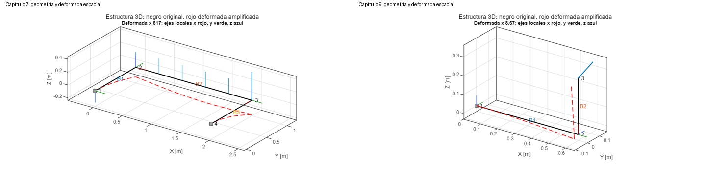
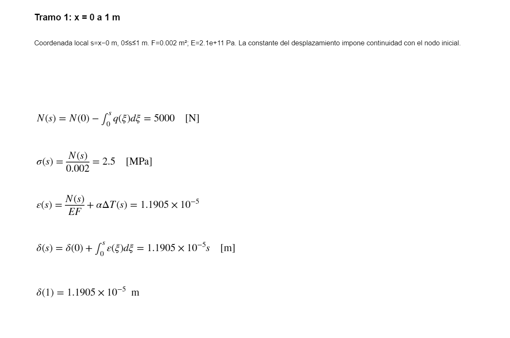

# Structural Analysis Workbench

**MATLAB structural calculations with editable inputs, engineering diagrams, and a calculation report generated from the current case.**

The workbench brings together 20 model families in one Live Script. It covers member and section calculations, planar and spatial structures, selected strength and stability checks, and linear elastic 3D solids. Sixteen standalone reference Live Scripts provide worked explanations of the underlying methods.

The interface and detailed user guides are currently in Spanish. This README provides the project overview and setup instructions in English.



## Main capabilities

- Define geometry, material, loads, supports, and acceptance limits in a dedicated input section.
- Generate the diagrams appropriate to the selected model: axial force, shear, moment, stress, strain, displacement, or other model-specific results.
- Display spatial member geometry, local axes, and amplified deformed shapes for supported 3D models.
- Produce rendered equations with numerical substitutions, results, units, and intermediate steps where implemented.
- Compare supported mechanical load cases and distinguish completed calculations from incomplete engineering checks.
- Import a connected STEP/STL solid for static elastic analysis with mesh comparison and global equilibrium checks.

## Requirements

| Component | Requirement |
|---|---|
| MATLAB | Developed and checked with **R2024b**; other releases have not been verified |
| Live Editor | Used to edit and execute the `.mlx` documents |
| PDE Toolbox | Required for `solido3d` and test suites that exercise that family |
| Symbolic Math Toolbox | Not required for the calculation report |
| SolidWorks | Not required; native CAD assemblies must be exported and prepared separately |

## Quick start

1. Download or clone the **entire repository**, preserving its folder structure.
2. Open the repository folder in MATLAB and run **`START_HERE`**.
3. In the integrated Live Script, keep the initial `seleccion="directa"` and `analisis="axial"` for the first run.
4. Press **Run** to execute the complete document.
5. Select the required analysis family, edit its active `datos` block, and run the complete document again.

`START_HERE.m` adds the bundled MATLAB files to the current session's path, checks the required library files, and opens [`ANALISIS_ESTRUCTURAL_INTEGRADO.mlx`](matlab/ANALISIS_ESTRUCTURAL_INTEGRADO.mlx). It does not solve a case automatically or permanently change the MATLAB path.

The [input guide](docs/GUIA_ANALISIS_INTEGRADO.md) explains fields, matrix columns, sign conventions, units, and templates for all 16 reference families and the solid module. Edit the inputs in the Live Script; `ae_datos.m` supplies library defaults and examples rather than overriding that document's input block.

Use SI inputs unless a field explicitly states otherwise. A full **Run** rebuilds the results from the current inputs; running only a report section can display a previously computed solution.

## Available models

| Area | Analysis keys | Implemented scope |
|---|---|---|
| Members and structures | `axial`, `cercha`, `torsion`, `viga`, `flexion_oblicua`, `sistema_barras` | Axial members, trusses, shafts, beams, biaxial bending, and supported planar/spatial frame modes |
| Sections and stress states | `seccion`, `tensor`, `resistencia_combinada`, `seccion_general` | Section properties, stress/strain tensors, combined loading, polygonal/thin-walled sections, and single-cell torsion |
| Stability and material response | `estabilidad`, `dinamica`, `plasticidad`, `fatiga`, `placa_local` | Column stability, selected impact/rotation models, ideal monotonic plasticity, defined stress cycles, and rectangular plate local buckling |
| Specialized models | `lamina`, `barra_curva`, `compatibilidad`, `uniones` | Axisymmetric membrane shells, curved members, selected compatibility problems, and nominal connection checks |
| Continuum solids | `solido3d` | Static isotropic linear elasticity for a box or one connected imported solid |

Each family has explicit assumptions and supported modes. Selecting a key does not establish that the model represents the physical component. New material laws or unsupported boundary conditions require extending the implementation.

## Calculation report

The integrated document keeps the numerical calculation and its mathematical explanation together. The report uses MATLAB's LaTeX renderer and draws equations with the values of the solved case. The amount and form of detail depend on the model.



## Repository layout

```text
START_HERE.m      Entry point: prepare the path and open the integrated document
matlab/           Integrated Live Script, 16 reference modules, solvers, and tests
docs/             Input guide, module index, model preparation, and technical notes
assets/           Generic example previews used in this README
verification/     Verification history, packaged-source hashes, and packaging checks
```

Keep the files inside `matlab/` together: the integrated solver checks for the 16 reference documents and its helper routines. You do not need to execute the reference modules before using the integrated document.

Documentation:

- [Input guide and case templates — Spanish](docs/GUIA_ANALISIS_INTEGRADO.md)
- [Reference module index and scope — Spanish](docs/LEEME.md)
- [Preparing a real structural model — Spanish](docs/PREPARAR_MODELO_ESTRUCTURAL.md)
- [Spatial model conventions — Spanish](docs/REVISION_3D.md)
- [Verification record — English](verification/VERIFICATION.md)
- [Uploading this package — Spanish](docs/PUBLICAR_EN_GITHUB.md)

## Verification

The existing integration record dated **2026-10-19** contains **96 accumulated checks** across integration/regression, axial presentation, sections/connections/plates/load cases, and 3D solids. In the latest numerical revision, the nine solid checks were rerun; the other 87 belong to earlier verification. This is code verification within the implemented models, not validation of every physical structure.

For the 96-check integration set, add `matlab/` to the MATLAB path and run:

```matlab
COMPROBAR_INTEGRADO;
COMPROBAR_INTEGRADO_AXIAL;
COMPROBAR_LECCIONES;
COMPROBAR_SOLIDO_INTEGRADO;
```

PDE Toolbox is needed for the suites that exercise solids. Additional standalone-module checks are supplied as `COMPROBAR_CALCULOS` and `COMPROBAR_ESPACIAL`; their results are separate from the 96-check integration record. See [verification details](verification/VERIFICATION.md) for provenance and packaging checks.

## Engineering scope and limitations

This is a structural analysis prototype for traceable calculations and model development. The user defines the physical idealization, material properties, constraints, load combinations, and acceptance criteria.

The solid module does not automatically create assembly contacts, bolt preload, weld models, or connection flexibility. Imported face identifiers must be checked after geometry changes. Missing material limits, insufficient mesh convergence, or other incomplete checks must remain visible when interpreting a result. A completed solve or balanced global reaction does not establish design acceptance.

Reference PDFs, private component CAD, saved project solutions, and temporary files are excluded from this distribution. Generic examples are included in the Live Scripts and library defaults.

## License

This project is licensed under the MIT License. See [LICENSE](LICENSE).
MATLAB and its toolboxes are separate products and are not included.
